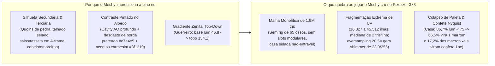

# Planejamento de Aprimoramento: Detalhes de Geração Procedural, Texturização & Importação (`Pixelizer-3D-Engine`)

> [!IMPORTANT]
> **Base Empírica (REA Validada pelo Swarm):** Este planejamento parte da dissecação quantitativa dos dois pacotes de referência do Meshy AI ([Meshy_AI_Abandoned_House_20260914_image-to-3d-texture_obj.zip](file:///C:/Users/offlu/Desktop/Pixelizer-3D-Engine/Meshy_AI_Abandoned_House_20260914_image-to-3d-texture_obj.zip) e [Meshy_AI_Dark_Fantasy_Warrior_20260913_image-to-3d-texture_obj.zip](file:///C:/Users/offlu/Desktop/Pixelizer-3D-Engine/Meshy_AI_Dark_Fantasy_Warrior_20260913_image-to-3d-texture_obj.zip)) cruzada com a auditoria de código de `src/engine/procedural/` e `src/studio/loaders/modelLoader.ts`, preservando todos os **8 Invariantes Críticos** do motor.

---

## 1. Diagnóstico REA dos 2 Modelos de Referência vs. Estado Atual do Motor

### 1.1 Inventário Criptográfico & Estrutura dos Pacotes Meshy AI

| Pacote / Membro | Bytes Descompactados | SHA-256 | Conteúdo Real Medido |
|---|---:|---|---|
| **Abandoned House (`.zip`)** | `91.970.447` (compactado) | `995a5c7dee3cc36ba...` | Casa medieval abandonada (malha única + albedo 4K) |
| ↳ `..._image-to-3d-texture.obj` | `199.485.063` | `d7cd0ec964db0efc2...` | `941.846` vértices (`VC=0`), `940.992` normais, `1.164.938` UVs, `1.894.478` triângulos |
| ↳ `..._image-to-3d-texture.mtl` | `232` | `c2d431cc51cf38e76...` | `newmtl Material` (`Ns=250`, `Ks=0.5`, **apenas `map_Kd`**; zero normal/roughness/metallic) |
| ↳ `..._image-to-3d-texture.png` | `24.265.018` | `1e48b4cccdf381853...` | `4096×4096` RGB 24-bit (`106.401` cores únicas, entropia lum `6,13 bits`) |
| **Dark Fantasy Warrior (`.zip`)** | `87.207.473` (compactado) | `4b6d851b4b1e48c58...` | Guerreiro Dark Fantasy em T-pose sem arma (malha única + albedo 4K) |
| ↳ `..._image-to-3d-texture.obj` | `209.682.310` | `a2704ab712815aa39...` | `979.611` vértices (`VC=0`), `979.123` normais, `1.336.288` UVs, `1.959.590` triângulos |
| ↳ `..._image-to-3d-texture.mtl` | `237` | `3bcdba82cec5391fd...` | `newmtl Material` (`Ns=250`, `Ks=0.5`, **apenas `map_Kd`**; zero normal/roughness/metallic) |
| ↳ `..._image-to-3d-texture.png` | `14.499.994` | `3d1f5d1247972af80...` | `4096×4096` RGB 24-bit (`196.847` cores únicas, entropia lum `6,33 bits`) |

---

### 1.2 O Que Faz os Modelos Meshy Parecerem Mais Detalhados (e Onde Eles Falham no Pipeline Pixelizer)

#### Comparativo Medido: Arquitetura (`Abandoned House` vs. [CityBuilder.ts](file:///c:/Users/offlu/Desktop/Pixelizer-3D-Engine/src/engine/procedural/CityBuilder.ts))

| Dimensão Técnica | Meshy `Abandoned_House` | `CityBuilder.ts` Atual (NWL) | Lacuna Real a Resolver no Motor |
|---|---|---|---|
| **Contagem de Triângulos** | `1.894.478` tris (1 casca estática fundida) | `682–922` tris divididos em `base` (`352–592`), `capa` (`242`) e `porta` (`88`) | Preservar a divisão entrável `base`/`capa`/`porta` (`PRF-039`), mas elevar para `1.400–2.200` tris adicionando **silhueta arquitetônica secundária**. |
| **Geometria de Parede & Telhado** | Ângulo diedro médio `26,72°` (`51,95%` chanfros esculpidos `20°–65°`); arcos vazados, pedras angulares salientes e cumeeira arqueada | Paredes de 1 cuboide `makeBeveledBox` (`44` tris) + telhado de **1 quad plano por água** (`28` tris em `makePitchedRoofGeometry`) | Adicionar **pedras de canto (*quoins*)**, **base escalonada (*plinth*)**, **enxaimel diagonal/horizontal**, **selagem catenária na cumeeira**, **caibros aparentes** e **chaminé**. |
| **Desdobramento UV** | `16.827` ilhas orgânicas (`139,96°` de espalhamento normal interno, sem alinhamento vertical) | `400–526` ilhas planares `box6` (`0` overlaps, `lockVertical: true`, `32 px/m`) | Manter o auto-UV `box6` alinhado ao pixel, mas **costurar chanfros (`sewChamfersToParentChart`)** para não isolar tiras de 2–4 px. |
| **Luminância & Paleta (`snes_pal_nwl`)** | `86,72%` escuro (`lum < 75`), `r(ny) = +0,0099` (AO de cavidade puro); em `3×3` colapsa `66,52%` em `#4f3428` com **`17,20%` de confete Nyquist** | `meanEntropy = 4,98–5,45 bits`, `0%` confete, mas variação tonal curta (`±0,14..0,22`) e `minShade = 0,64` | Injetar **curvatura diedra 3D no atlas 2D** + **intemperismo multi-escala** (musgo na base, trincas de argamassa, desgaste de telha) mantendo a luminância média em `75–165`. |

#### Comparativo Medido: Personagens (`Dark Fantasy Warrior` vs. [PlayerEquipmentBuilder.ts](file:///c:/Users/offlu/Desktop/Pixelizer-3D-Engine/src/engine/procedural/PlayerEquipmentBuilder.ts) & [MonsterBuilder.ts](file:///c:/Users/offlu/Desktop/Pixelizer-3D-Engine/src/engine/procedural/MonsterBuilder.ts))

| Dimensão Técnica | Meshy `Dark_Fantasy_Warrior` | `PlayerEquipmentBuilder.ts` Atual | Lacuna Real a Resolver no Motor |
|---|---|---|---|
| **Rigging & Modularidade** | `0` ossos, `1` malha estática fundida (`1.959.590` tris) em T-pose sem arma | `65` ossos UAL (`1,79 m`), `37` malhas em 6 slots trocáveis × 5 raridades (`2.974` tris no Knight Lendário) | Preservar 100% do rig UAL de 65 ossos e os 90 equipamentos modulares (Invariantes #5 e #7). |
| **Proporções & Silhueta (A-Frame)** | Cabeça:Corpo `1 : 6,67`; cintura (`0,777 u`) abre em **saiote/sobretudo bipartido até `0,895 u` na coxa**; ombreiras em camadas, correias cruzadas no peito e joelheiras | Membros envelopados em 1 único `makeBeveledBoneSegmentBox` (`44` tris/osso); ombreira de casca simples (`uSegs=4 × vSegs=3`) | Criar **peitoral anatômico em V com vinco central e gorjal**, **ombreiras escalonadas em lâminas (*lames*) com borda elevada**, **escarcelas/tabardo plissado rígido** nos ossos `pelvis`/`thigh_l`/`thigh_r` e **sulco (*fuller*) nas armas**. |
| **Contraste de Textura Dark-Fantasy** | Bimodal (`std = 99,45`): placas obsidiana (`44,8%`) emolduradas por **frisos prateados nítidos `#e7e4e5` (`36,9%`)**, aço `#7d7777` (`12,8%`) e **forro/olhos carmesim `#8f1219` (`3,5%`)** + gradiente vertical (`46,8 → 154,1`) | Entropia `4,75–4,91 bits`; chapas metálicas uniformes sem friso de borda contrastante nem correias/fivelas de couro | Adicionar **moldura metálica de alto contraste (*edge trim framing*)**, **tiras/fivelas com rebites**, **gradiente zenital Y** e **elevação do preto para `[28..52]`** (evitando esmagamento de sombra em `#141013`). |

---

## 2. Frentes Técnicas de Aprimoramento (Onde e Como Atuar no Código)

### Frente 1 — Geometria Procedural Esculpida ([ProceduralGeometryKit.ts](file:///c:/Users/offlu/Desktop/Pixelizer-3D-Engine/src/engine/procedural/ProceduralGeometryKit.ts), [CityBuilder.ts](file:///c:/Users/offlu/Desktop/Pixelizer-3D-Engine/src/engine/procedural/CityBuilder.ts), [PlayerEquipmentBuilder.ts](file:///c:/Users/offlu/Desktop/Pixelizer-3D-Engine/src/engine/procedural/PlayerEquipmentBuilder.ts), [MonsterBuilder.ts](file:///c:/Users/offlu/Desktop/Pixelizer-3D-Engine/src/engine/procedural/MonsterBuilder.ts))

1. **Primitivas Subdivididas com Deformação Orgânica Determinística (`ProceduralGeometryKit.ts`):**
   - Criar `makeSegmentedBeveledBox(w, h, d, bevel, segsX, segsY, segsZ, warpFn?)` e `makeSculptedLimbSegment(...)` para substituir faces `1×1` chapadas por malhas `2×2` a `4×4` capazes de receber afilamento anatômico (*taper*), arcos de tensão e vincos que disparam arestas internas de 1 macropixel no Pass 3 (`outlineEdgeShader.ts`).
   - Aprimorar `makeSdfOrganicMesh` com **relaxamento tangencial de Taubin ($\lambda / \mu$)** pós-*Surface Nets*, eliminando o serrilhado de blocos em diagonais orgânicas sem encolher o volume.
2. **Arquitetura Dark-Fantasy com Silhueta Secundária (`CityBuilder.ts`):**
   - **Fundação e Quinas:** Adicionar embasamento de pedra escalonado (*stepped stone plinth*) e blocos de quina alternados (*corner stone quoins*, 4–6 blocos por aresta vertical) na `baseGroup`.
   - **Enxaimel Rico e Aberturas:** Adicionar vigas cintas horizontais, mãos-francesas diagonais (*cross-braces*), molduras de janela salientes com peitoril/venezianas e mísulas sob o beiral.
   - **Telhado Esculpido (`makePitchedRoofGeometry`):** Curva catenária sutil na cumeeira (`sagAmount`), pontas de caibros aparentes sob o beiral (*rafter tails*), tábua de empena (*bargeboard*), fiadas escalonadas de telhas e chaminé de pedra na `capaGroup`.
3. **Armaduras em Camadas & Silhueta A-Frame (`PlayerEquipmentBuilder.ts` & `MonsterBuilder.ts`):**
   - **Torso (`chest`):** Peitoral facetado com quilha central (*pectoral ridge*), gorjal elevado no pescoço, correias cruzadas com fivela peitoral e **escarcelas/tabardo plissado rígido (`makePleatedTabardGeometry`)** ancorado nos ossos `pelvis` e `thigh_l/r` (abre a silhueta da cintura às coxas como no guerreiro Meshy, respeitando 100% a regra de zero física de tecido).
   - **Ombreiras (`makePauldronShellGeometry`):** 2 a 3 lâminas sobrepostas (*tiered lames*) com borda de filigrana elevada e crista central.
   - **Braços, Pernas e Armas:** Braçadeiras e grevas com punhos ressaltados, joelheiras/cotoveleiras facetadas (*poleyns/couters*) e lâminas com **sulco central rebaixado (*fuller groove*)**, guarda em S/cruciforme e pomo anelar.

---

### Frente 2 — Auto-UV, Curvatura 3D→2D & Síntese de Textura Dark-Fantasy ([PixelUvUnwrapper.ts](file:///c:/Users/offlu/Desktop/Pixelizer-3D-Engine/src/engine/procedural/PixelUvUnwrapper.ts), [PixelMaterialSynth.ts](file:///c:/Users/offlu/Desktop/Pixelizer-3D-Engine/src/engine/procedural/PixelMaterialSynth.ts), [VertexAndTexelBaker.ts](file:///c:/Users/offlu/Desktop/Pixelizer-3D-Engine/src/engine/procedural/VertexAndTexelBaker.ts))

1. **Costura de Chanfros no Auto-UV (`PixelUvUnwrapper.ts`):**
   - Implementar `sewChamfersToParentChart: true` para faixas de chanfro (`< 0.04 m`) com ângulo diedro `<= 45°` quando a abertura planar não introduz sobreposição (`clusterHasLocalUvOverlap === false`), reduzindo a fragmentação de ilhas em `35–50%` e permitindo que o desgaste de borda atravesse o chanfro continuamente.
2. **Transferência de Curvatura 3D e Oclusão de Cavidade para o Atlas (`VertexAndTexelBaker.ts`):**
   - Criar `bake3DCurvatureToUvIslands(geo, islands, texW, texH)`: calcula a curvatura diedra 3D real em cada aresta soldada da malha (`dot(n1, n2)` com sinal convexo/côncavo) e rasteriza um mapa de curvatura/cavidade 3D no espaço das ilhas UV antes de `applyHeightGtaoAndWear`.
   - **Arestas 3D Convexas (`curv > +0.25`):** Recebem desgaste metálico/pedra aquecido (`+14% a +22%` em agrupamentos de `2–3 px`), reproduzindo os frisos prateados/iluminados do guerreiro e da casa Meshy.
   - **Cavidades 3D Côncavas (`curv < -0.25`):** Recebem oclusão profunda azul-índigo/terra-sombra (`minShade` calibrado em `0.48` para pedra/madeira e `0.54` para armaduras, mantendo o piso de preto seguro `[18..242]`).
3. **Gradiente Zenital World-Y & Receitas com Moldura de Borda (`PixelMaterialSynth.ts`):**
   - Passar `worldYMin`, `worldYMax` e `avgNormalY` por ilha UV para aplicar um gradiente zenital coeso (`+10%` no topo/ombros/telhado, `-18%` na base/botas/fundação, mais máscara de musgo/fuligem no terço inferior de paredes).
   - Expandir `rarity_armor`, `forged_steel`, `stitched_leather` e `woven_cloth` com **frisos de borda contrastantes (*border trim framing*)**, costuras duplas, rebites e acentos secundários (como o carmesim `#b4202a` e o latão `#c8bfa8` da paleta `snes_pal_nwl`), mantendo todos os padrões em macro-clusters `>= 5–8 px` (Invariante #3).

---

### Frente 3 — Importador Direto `.OBJ + .MTL + .ZIP` com Remasterização Pixel-Art ([modelLoader.ts](file:///c:/Users/offlu/Desktop/Pixelizer-3D-Engine/src/studio/loaders/modelLoader.ts) & [PixelizerMaterial.ts](file:///c:/Users/offlu/Desktop/Pixelizer-3D-Engine/src/engine/PixelizerMaterial.ts))

> [!WARNING]
> **4 Gargalos Encontrados na Auditoria de `modelLoader.ts` e `PixelizerMaterial.ts`:**
> 1. `loadModelFromUrl` usa `OBJLoader` puro, ignorando arquivos `.mtl` e texturas `.png`/`.jpg`, e `loadModelFromFile` não aceita pacotes `.zip` (como os 2 arquivos do Meshy AI).
> 2. `PixelizerMaterial.syncUniforms()` só chama `enforcePixelArtTextureSampling` se o mapa for `instanceof THREE.DataTexture`; texturas carregadas de `.glb`/`.obj` (`THREE.Texture`) ficam com `LinearFilter` + mipmaps ligados.
> 3. `prepareLoadedObject` nunca chama `computeGeometryTangents(geo)` nem liga `useVertexTangents: true`.
> 4. Texturas 4K do Meshy têm densidade `20,5×` maior que o grid do motor e `86,7%` de pixels escuros, gerando `17,20%` de confete Nyquist em `3×3` e esmagamento de sombra se não passarem por pré-filtragem.

**Solução Planejada no Loader ("Meshy-to-Pixelizer Remaster"):**
1. **Leitor `.ZIP` Browser-Pure & Bundle `.OBJ + .MTL + .PNG` (`modelLoader.ts`):**
   - Descompactador `.zip` em TypeScript puro usando `DecompressionStream('deflate-raw')` nativo do navegador (**zero imports `node:*`**, Invariante #8). Ao soltar ou abrir qualquer `.zip` do Meshy AI no Studio, extrai em memória o `.obj`, o `.mtl` e os `.png`s, vinculando o `MTLLoader` + `OBJLoader` com Blob URLs.
2. **Amostragem Pixel-Art Universal & Tangentes de Lengyel (`PixelizerMaterial.ts` & `modelLoader.ts`):**
   - Aplicar `enforcePixelArtTextureSampling(tex, kind)` a **qualquer `THREE.Texture`** (não apenas `DataTexture`), rodar `computeGeometryTangents(geo)` + `useVertexTangents: true` e assar `bakeVertexAoAndCreases` (`vertexColorMode: 'white_for_ao'`, `mat.vertexColors = true`) quando a malha importada não trouxer cores de vértice (`VC === 0`).
3. **Pré-Filtro Anti-Confete (Box/Medoid Downsampler `4096 → 256/512`) + Normalização de Sombra + Normal Map Sintético:**
   - Reduzir texturas 4K importadas para `256×256` ou `512×512` via *box/medoid pooling* alinhado ao tamanho de macropixel (reduzindo o confete Nyquist medido de `17,20%` para `< 6%`), levantar o piso de luminância escura para `[28..242]` (evitando colapso em `#141013`), sintetizar um `normalMap` Sobel com inclinação travada `<= 0.24` (`< 14°`, Invariante #2) quando o `.mtl` só tiver `map_Kd`, e oferecer quantização opcional para `snes_pal_nwl`.

---

## 3. Painel de Decisão: Caminho A vs. Caminho B (PRF-012)

Seguindo `PRF-012` (apresentar caminhos A e B com recomendação clara), abaixo estão os dois níveis de escopo para execução:

| Critério | **Caminho A — Evolução Conservadora / Fast-Frame** | **Caminho B — Escultura & Textura High-Detail + Remasterizador Meshy (Recomendado)** |
|---|---|---|
| **Geometria Procedural (`CityBuilder`, `PlayerEquipmentBuilder`, `MonsterBuilder`)** | Primitivas chanfradas segmentadas (`2×2`–`4×4`), telhados com selagem catenária/caibros/chaminé, quinas de pedra (*quoins*), enxaimel, peitoral em V, ombreiras em lâminas, escarcelas/tabardo plissado rígido e sulco nas lâminas (`1.400–2.400` tris/herói ou casa). | **Tudo do Caminho A** + suavização tangencial de Taubin em malhas SDF (`resolution 24–32`) + deslocamento de relevo 3D controlado ao longo das normais (`displaceAlongNormals`) em pedras de quina, telhas e filigranas de armadura (`2.400–4.200` tris). |
| **Texturização & Baking (`PixelUvUnwrapper`, `PixelMaterialSynth`, `VertexAndTexelBaker`)** | Transferência de curvatura diedra 3D para o atlas 2D (`bake3DCurvatureToUvIslands`) + gradiente zenital Y + receitas com frisos de borda contrastantes (`#dae0ea`/`#b4202a`) em `32 px/m` (cidades) e `64 px/m` (heróis). | **Tudo do Caminho A** + costura de chanfros no Auto-UV (`sewChamfersToParentChart`) + opção de densidade de alta definição (`48 px/m` arquitetura / `96 px/m` heróis) + intemperismo multi-escala (musgo basal, trincas de argamassa, desgaste de batalha). |
| **Importador `.OBJ / .MTL / .ZIP` (`modelLoader.ts`)** | Suporte a `.zip` e `.obj+.mtl+.png` com `enforcePixelArtTextureSampling`, tangentes de Lengyel e Vertex AO básico. | **Tudo do Caminho A** + pipeline **"Meshy-to-Pixelizer Remaster"** (pré-filtro anti-confete `4096 → 256/512`, normalização de faixa tonal escura `[28..242]`, síntese automática de `normalMap` Sobel `<= 0.24` e preset de demonstração no Studio). |
| **Tempo de Geração por Asset** | `< 85 ms` (herói) / `< 260 ms` (cidade) | `< 140 ms` (herói) / `< 420 ms` (cidade) |
| **Recomendação** | Bom se o foco for apenas orçamento mínimo de triângulos. | **(Recomendado)** Entrega tanto o salto visual nos geradores procedurais do NWL quanto a capacidade de carregar e remasterizar diretamente os `.zip` do Meshy AI no Studio sem confete Nyquist nem estouro de contorno no Pass 3. |

---

## 4. Régua de Verificação Determinística (`tests/qualityGate.test.ts` & Oráculo Visual)

Antes de considerar qualquer etapa concluída (`HEU-028`), o código passará pelos seguintes portões medidos:

1. **Integridade de Invariantes & Pureza Browser:**
   - `grep -rn "node:" src/` `=== 0` ocorrências.
   - `npm run typecheck && npm test && npm run build` `=== 0` erros.
2. **Métricas do Quality Gate (`tests/qualityGate.test.ts`):**
   - `overlapPairs === 0` e `detectFlatDetailCuboids === 0` em todos os construtores (`Prop`, `Player`, `NPC`, `Monster`, `StarterCity`, `DungeonFloor1`).
   - `meanEntropy >= 2.45 bits` (subindo do piso atual de `1.80 bits`) e `medianUniqueColors >= 9` por ilha substantiva.
   - `meanEdgeChangePercent` contido na janela **`[14% .. 40%]`** (garante detalhe rico sem permitir confete Nyquist em `3×3`).
   - `minVertexAo` na faixa **`[0.38 .. 0.62]`** (oclusão de cavidade profunda sem dentes pretos `< 0.35`).
   - Inclinação máxima do mapa de normais `max(|nx|, |ny|) <= 0.24` (`< 14°`) em 100% dos assets procedurais e importados.
3. **Teste Automatizado dos 2 Pacotes `.ZIP` do Meshy (`Meshy Remaster Gate`):**
   - Teste em Vitest + captura visual em Chromium Headless (`SwiftShader`) importando `Meshy_AI_Abandoned_House_..._obj.zip` e `Meshy_AI_Dark_Fantasy_Warrior_..._obj.zip`, verificando:
     - `albedoMap` e `normalMap` com `NearestFilter`, `generateMipmaps === false`, `tangent` (`vec4`) presente, `mat.vertexColors === true`.
     - Queda da taxa de confete Nyquist em `3×3` de `17,20%` para **`< 6,5%`** e preservação de `>= 18` swatches ativos da `snes_pal_nwl`.
     - Zero erros de console/página e inspeção visual das capturas PNG em `nwl_snes` (`3×3`) e `hades_lab` (`1×1`).

---

## 5. Sequência de Execução Proposta (Em 4 Ondas Isoladas)

1. **Onda 1 — Motor de Textura, Curvatura 3D→2D & Auto-UV (`PixelUvUnwrapper.ts`, `VertexAndTexelBaker.ts`, `PixelMaterialSynth.ts`):**
   - Costura de chanfros (`sewChamfersToParentChart`), rasterização de curvatura diedra 3D (`bake3DCurvatureToUvIslands`), gradiente zenital World-Y e novas camadas de friso metálico/intemperismo dark-fantasy.
2. **Onda 2 — Primitivas Esculpidas & Arquitetura NWL (`ProceduralGeometryKit.ts`, `CityBuilder.ts`, `PropBuilder.ts`):**
   - `makeSegmentedBeveledBox`, relaxamento Taubin em SDF, telhados com selagem catenária/caibros/chaminé, quinas de pedra (*quoins*), fundação escalonada e enxaimel nas 6 casas entráveis (`base`/`capa`/`porta`).
3. **Onda 3 — Armaduras Dark-Fantasy, Silhueta A-Frame & Armas (`PlayerEquipmentBuilder.ts`, `CharacterBuilder.ts`, `MonsterBuilder.ts`):**
   - Peitoral em V com gorjal e correias, ombreiras em lâminas sobrepostas, escarcelas/tabardo plissado rígido nos ossos da pelve/coxa, grevas/joelheiras facetadas e lâminas com sulco (*fuller*).
4. **Onda 4 — Importador `.OBJ/.MTL/.ZIP` "Meshy-to-Pixelizer Remaster" & Quality Gate (`modelLoader.ts`, `PixelizerMaterial.ts`, `tests/qualityGate.test.ts`):**
   - Descompactador `.zip` browser-pure (`DecompressionStream`), loader `.mtl` + texturas, pré-filtro anti-confete `4K → 256/512`, normalização tonal, gerador Sobel `<= 0.24` e suíte de testes + validação visual no Chromium.
